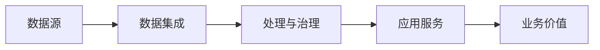

# [方案名称]

> 一句话说明：这套方案解决什么问题、用于什么场景。

**方向**：医疗软件 / 医疗大数据 / 医疗大模型
**场景**：（如：某类医院、某个业务环节）
**关键词**：（如：数据治理、互联互通、病历质控）

---

## 一、背景与痛点

描述项目背景和要解决的问题：

- 现状是怎样的？
- 存在哪些痛点？（效率、质量、合规、成本等）
- 为什么要做这件事？

## 二、建设目标

- 目标 1：……
- 目标 2：……
- 目标 3：……

## 三、整体架构

用文字或图示描述方案的整体架构。可以用 GitHub 支持的 Mermaid 画图，例如：

## 四、核心能力

| 能力模块 | 说明 | 关键技术 |
|---------|------|---------|
| 模块一 | …… | …… |
| 模块二 | …… | …… |

## 五、实施路径

1. **第一阶段**：……（如：需求调研、现状梳理）
2. **第二阶段**：……（如：方案设计、系统建设）
3. **第三阶段**：……（如：试运行、推广）

## 六、效果与价值

- 业务效果：……
- 效率提升：……
- 其他收益：……

## 七、经验与反思

- 做对了什么：……
- 踩过的坑：……
- 如果重来会怎么改进：……

---

*注：本文为脱敏后的通用方案描述，不含客户信息与真实业务数据。*